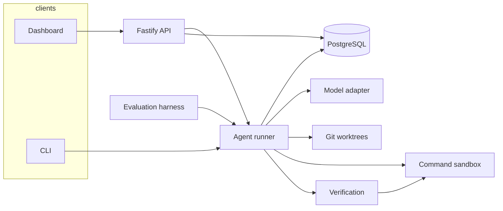

# Architecture

OpenEngineer is one Node process (or a CLI invocation of the same libraries) plus PostgreSQL. The dashboard is a static React app. There is no separate worker service.

## Boundaries

- `@openengineer/shared` holds Zod schemas, task states, and error codes. Persisted JSON is parsed with those schemas when it is read back.
- `@openengineer/core` owns the runner, tool policy, git operations, sandbox, and verification. It depends on a `TaskStore` interface and an in-memory store used by tests and the evaluation harness.
- `@openengineer/db` implements `TaskStore` with Prisma.
- `@openengineer/api` and `@openengineer/cli` are adapters. They do not implement a second agent.
- `@openengineer/web` renders API data. It has no mock task list.
- `@openengineer/eval` runs the fixture tasks and writes measurements. It does not call a hosted model.

## Run loop

`runTask` claims a row, heartbeats, and moves through the states in `packages/shared/src/status.ts`. Illegal transitions throw.

1. **Inspect.** Read `package.json`, lockfiles, and `git status`. Skip `.env`, keys, and `.git`. Record whether the user's checkout is dirty.
2. **Plan.** The model may read files, then must call `submit_plan` or `request_clarification`. A clarification pauses in `awaiting_approval` and stores the transcript.
3. **Sandbox check.** Docker mode fails if the daemon or the configured image is missing. Process mode fails unless `OPENENGINEER_ALLOW_PROCESS_SANDBOX=true`. This happens before the worktree is created.
4. **Worktree.** `git worktree add -b openengineer/<taskId> <root>/<taskId> <HEAD>`. The only git config change is a one-shot `-c user.email` on the commit command, which does not rewrite the repository config.
5. **Implement.** Tools: list, read, search, edit, write, diff, allowlisted `run_command`, `finish`, `refuse`. Paths are resolved inside the worktree and symlinks that leave it are rejected.
6. **Test.** Commit the worktree, then run detected commands. The exit code is the result. Timeouts and missing exit codes are not passes.
7. **Repair.** On a required failure, the real output is appended and the implement loop runs again, up to `maxRepairAttempts`.
8. **Verify.** The same commands run again. `finalizeReport` computes `passed`, `failed`, or `inconclusive` only from required mechanical checks. Acceptance criteria stay `inconclusive` unless a command covers them. The optional model review is a separate field.

Cancellation is a database flag checked between steps, plus an abort signal that kills the in-flight model request and command process group.

## Model adapter

`ModelAdapter.complete` takes a purpose (`plan`, `implement`, `review`), the transcript, and tool definitions. OpenAI-compatible chat completions and the Anthropic Messages API are the two provider implementations. The scripted adapter returns the next fixture step from `turnIndex` and `repairAttempt`, so a new process can resume a script without hidden memory.

Provider token usage is stored when the API returns it. Otherwise the runner stores a length heuristic and sets `tokenAccounting` to `heuristic`. Cost uses a small built-in price table and stays `null` when the model is unknown or the accounting is not a provider bill. The scripted provider never invents a dollar cost.

## Persistence

Tasks, steps, approvals, plans, checkpoints, and verification reports are rows in PostgreSQL. On startup, running tasks whose heartbeat is older than 30 seconds are marked `failed` / `interrupted`. `awaiting_approval` and `queued` tasks are left alone. That is enough to inspect a run after a restart. It is not a resume of an in-progress edit.

## Commands the verifier runs

For npm, pnpm, and yarn, the verifier runs scripts named `test`, `lint`, `typecheck`, `build`, and `check` when they exist, plus `npx tsc --noEmit` when a TypeScript project has no typecheck script. The plan may name other commands. Those names are not executed unless they also match the allowlist and the agent calls `run_command`, which still goes through policy. Model-authored shell strings are not trusted.

## Trade-offs

- An in-process runner is easier to operate than a queue and a worker. Two API processes can claim the same task only if the heartbeat lock has expired.
- Raw `fetch` instead of provider SDKs keeps the dependency list smaller and the request shape visible.
- PostgreSQL is required even for the CLI, so the dashboard and the CLI share one history. The evaluation harness uses the in-memory store because it grades the engine, not the database.
- Node's test runner is the sample project's test framework so the fixture has zero dependencies and `npm test` works offline inside a sandbox.
